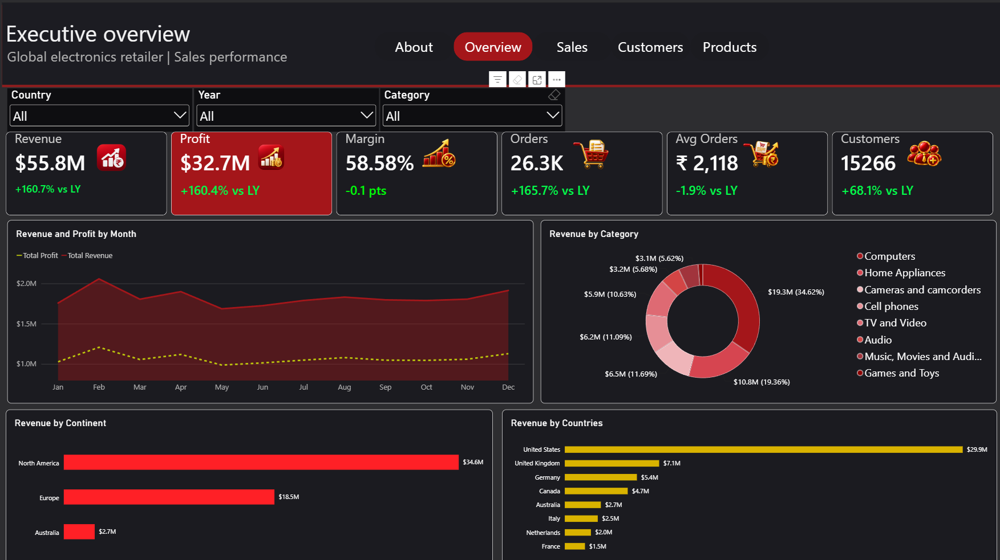
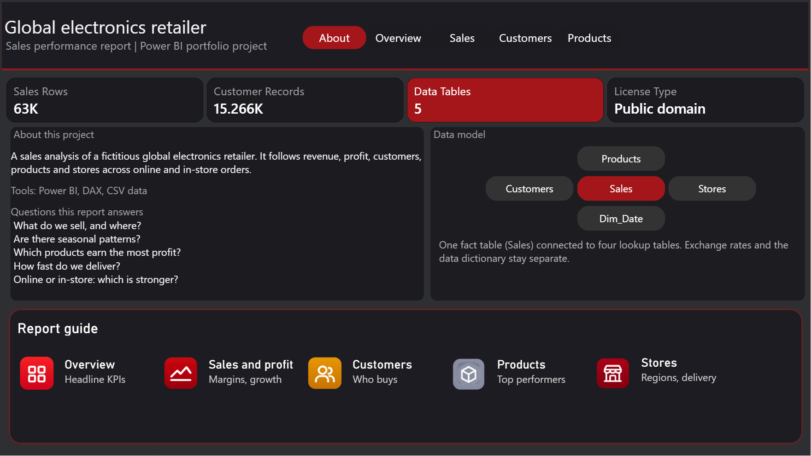
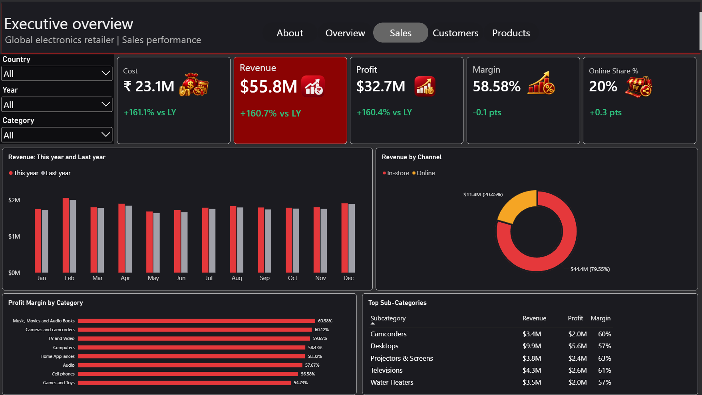
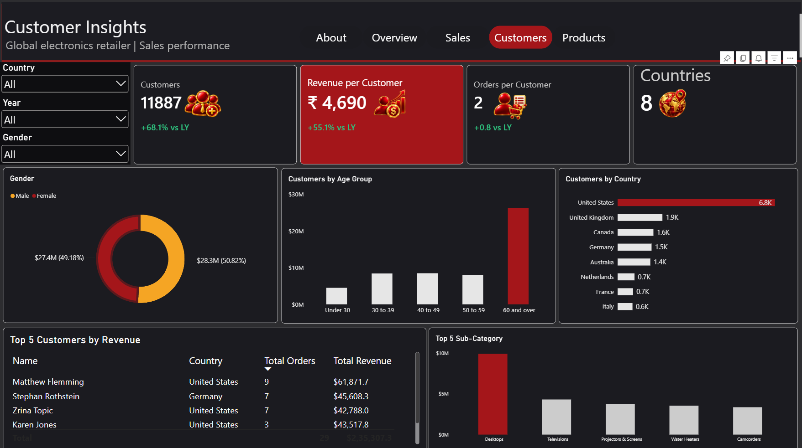
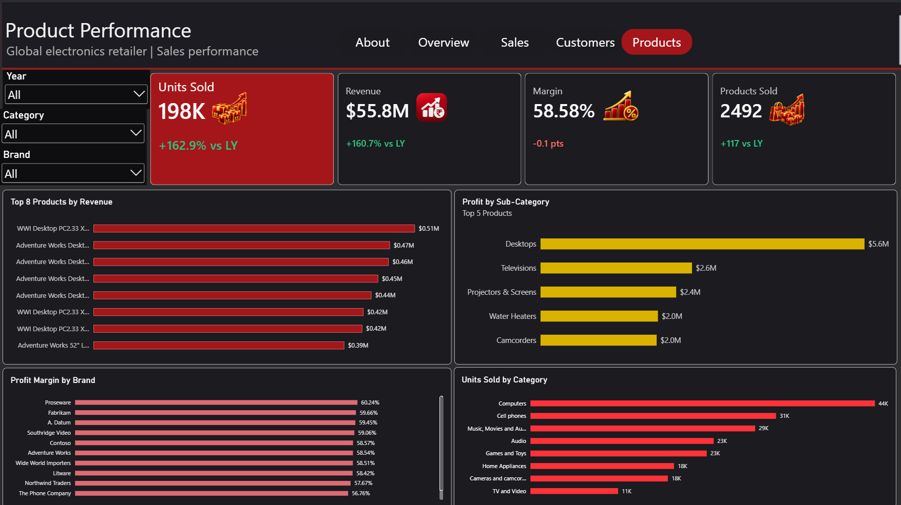

# Global Electronics Retailer: Sales Performance Dashboard

An interactive 5-page Power BI report that analyses sales, profit, customers and products for a fictitious global electronics retailer.

**Live report:** [View the dashboard in Power BI](https://app.powerbi.com/groups/me/reports/0cfe5770-2314-413c-9eee-6ea54345ac2c?ctid=56c1d497-700b-49cf-8f8d-3dd6b20d522f&pbi_source=linkShare)



---

## Project overview

This project turns raw transactional data into a clear business story. The report answers questions a sales or operations manager would ask:

- What are our revenue, profit and margin?
- Which products, categories and brands earn the most?
- Who are our customers, and where do they live?
- How do online and in-store sales compare?

## Dashboard pages

### 1. About
Dataset summary, data model and a guide to the report.



### 2. Executive overview
Headline KPIs (revenue, profit, margin, orders, average order value, customers), monthly trend, revenue by category, continent and country.


### 3. Sales and profit
Revenue comparison by month, profit margin by category, online vs in-store revenue split and top subcategories.



### 4. Customer insights
Customers by gender, age group and country, revenue per customer, orders per customer and the top 5 customers.



### 5. Product performance
Units sold, top products by revenue, profit by subcategory, margin by brand and units sold by category.



## Key insights

- The business generated about **$55.8M** in revenue and **$32.7M** in profit, a profit margin of about **58.6%**.
- The largest product category accounts for about **35%** of revenue (about $19.3M), and **Desktops** is the top subcategory with about $9.9M in revenue.
- **North America** brings in about $34.6M of revenue, and the **United States** alone is the largest market at about $29.9M.
- About **80%** of revenue comes from in-store sales and about **20%** from online.
- Profit margins are fairly even across categories, ranging from about **55%** to **61%**.
- Revenue is split almost evenly between male and female customers (about 51% and 49%).

## Dataset

- **Source:** [Maven Analytics Data Playground](https://mavenanalytics.io/data-playground), Global Electronics Retailer dataset (public domain)
- **Size:** about 62,884 sales rows, plus customers, products, stores and exchange rate tables
- **Tables:** Sales, Customers, Products, Stores, Exchange_Rates, Data_Dictionary

## Data model

A star schema with one fact table and four dimensions:

- **Sales** (fact) connects to **Products**, **Customers**, **Stores** and **Dim_Date**
- **Dim_Date** is a calculated calendar table, related to `Sales[Order Date]`
- **Exchange_Rates** and **Data_Dictionary** are kept separate

## Tools and skills

- **Power BI Desktop** for report design and publishing
- **DAX** for measures, time intelligence and conditional formatting
- **Power Query** for loading the data
- **Data modelling** with a star schema and a custom date table
- **Dashboard design** with a custom dark and red theme (`theme/DarkRed_Theme.json`), page navigation and slicers synced across pages

## DAX measures

Key measures built for this report:

```dax
Total Revenue = SUMX(Sales, Sales[Quantity] * RELATED(Products[Unit Price USD]))

Total Cost = SUMX(Sales, Sales[Quantity] * RELATED(Products[Unit Cost USD]))

Total Profit = [Total Revenue] - [Total Cost]

Profit Margin % = DIVIDE([Total Profit], [Total Revenue])

Total Orders = DISTINCTCOUNT(Sales[Order Number])

Avg Order Value = DIVIDE([Total Revenue], [Total Orders])

Total Customers = DISTINCTCOUNT(Sales[CustomerKey])

Revenue per Customer = DIVIDE([Total Revenue], [Total Customers])

Orders per Customer = DIVIDE([Total Orders], [Total Customers])

Online Revenue = CALCULATE([Total Revenue], Sales[StoreKey] = 0)

Online Share % = DIVIDE([Online Revenue], [Total Revenue])

Products Sold = DISTINCTCOUNT(Sales[ProductKey])
```

Calculated columns: **Channel** (Online or In-store, from `StoreKey`) on Sales, and **Age**, **Age Group** and **Age Group Order** on Customers.

Conditional formatting rules show green for positive changes and red for negative changes on the KPI cards.

## How to open the report

1. Download `report/Global_Electronics_Dashboard.pbix`.
2. Open it in [Power BI Desktop](https://powerbi.microsoft.com/desktop/) (free).
3. To apply the theme to another report, go to **View → Themes → Browse for themes** and choose `theme/DarkRed_Theme.json`.

## Repository structure

```
.
├── README.md
├── report/        Power BI file (.pbix)
├── data/          Source CSV files
├── theme/         Custom Power BI theme (JSON)
└── screenshots/   Dashboard page images
```

## Acknowledgements

Dataset provided by [Maven Analytics](https://mavenanalytics.io) under a public domain license.

## Author

**Ambati Sarath**
[LinkedIn](https://www.linkedin.com/in/ambatisarath/) | [sarathambati6@gmail.com](mailto:sarathambati6@gmail.com)
